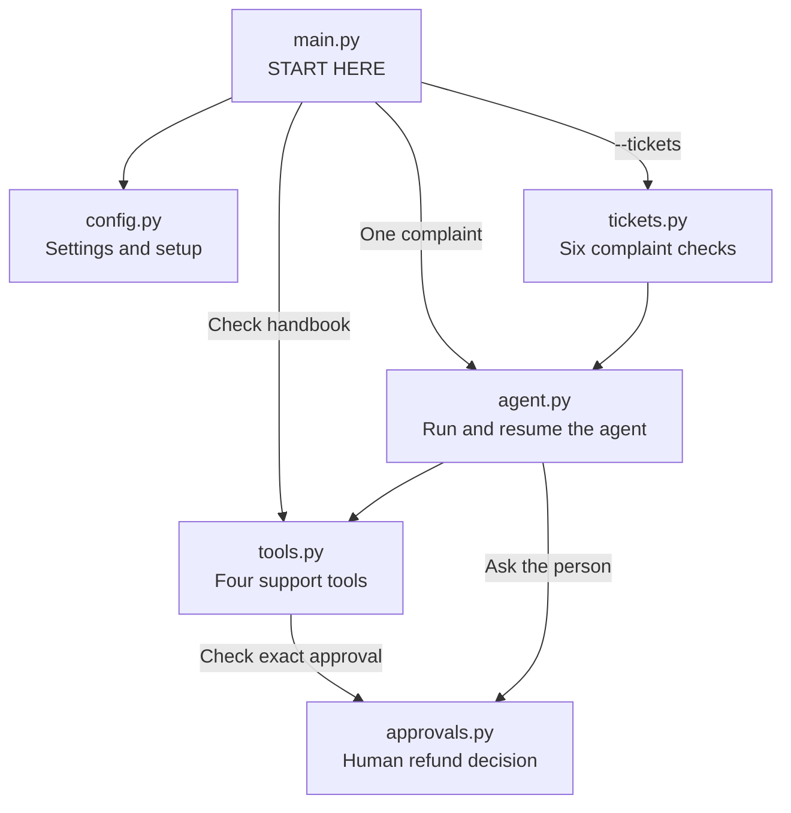

# Session 11 · AI Agents

Run a TrailMix support agent that checks the handbook, looks up an order, drafts a reply, and can propose a refund. TrailMix and all orders are fictional. Refunds require human approval and are recorded in a local CSV; no real money moves.

## Setup

Use **Python 3.13**. Fork the repository for your own copy, or clone the workshop repository:

```bash
git clone https://github.com/HruthikKommuru/CWRU-Fall-2026-Session-11.git
cd CWRU-Fall-2026-Session-11
python3.13 -m venv .venv          # Create the environment once.
source .venv/bin/activate        # Activate it in this terminal.
python -m pip install -r requirements.txt
cp .env.example .env             # Copy once, then enter your private keys.
```

On Windows PowerShell, create the environment with `py -3.13 -m venv .venv`, activate with `.\.venv\Scripts\Activate.ps1`, and copy the template with `Copy-Item .env.example .env`. In Command Prompt, activate with `.venv\Scripts\activate.bat`.

Add `GOOGLE_API_KEY` from [Google AI Studio](https://aistudio.google.com/apikey) and `PINECONE_API_KEY` from the [Pinecone console](https://app.pinecone.io/) to `.env`. The key file and environment folder are ignored by Git. Live service calls use quota and may incur charges.

**Session 10 must already be ingested.** The agent reads the existing Pinecone index `trailmix-handbook`, namespace `heading-800`, with up to four results per search. If it is empty, run `python chatbot.py --ingest` in the Session 10 repository first. This repository only reads the index.

The models remain Gemini `gemini-embedding-001` for embeddings and `gemini-3.7-flash` for the agent and drafting. Their names and other settings are in `config.py`.

## How to run

Open a terminal in the folder containing `main.py`. In each new terminal, activate the existing environment:

```bash
source .venv/bin/activate
```

On Windows PowerShell, use `.\.venv\Scripts\Activate.ps1` instead. Run `deactivate` when finished. You only create `.venv` and copy `.env` during the first setup.

Run one complaint:

```bash
python main.py "My stove smells of gas. Order T-1042. I want my money back."
```

Or run the six supplied test complaints:

```bash
python main.py --tickets
```

See the command help without making service calls:

```bash
python main.py --help
```

Keep the complaint inside quotation marks. Use one complaint or `--tickets` per command.

If the model proposes a refund, the program shows the exact order and amount and asks `approve / reject`. Type `approve` to allow that request, or `reject` to refuse it. Any other answer rejects. Approval still has to pass the Python refund checks.

At the end, the program prints the tool-choice logs and full conversation. Check the handbook citations and the reply. An approved refund is saved in the ignored file `output/refunds.csv`; running the program again keeps that history.

## What each Python file does

**Start only `main.py`.** It imports the other files as modules. Each module holds functions or settings needed by the final program.

| File | Its job |
| --- | --- |
| `main.py` | Read the terminal command, check setup, create the agent, and run the chosen input. |
| `config.py` | Store model names, prompts, paths, search settings, and the step limit. Load `.env` and set up logging. |
| `agent.py` | Create the agent, run it, pause for approval, resume, and print its trace. |
| `tools.py` | Define the four tools, read order details, search the existing handbook, and check and record fake refunds. |
| `approvals.py` | Ask a person about a proposed refund and keep one-use approval for its exact order and amount. |
| `tickets.py` | Run the six supplied complaints and compare their proposed tools with the expected tools. |

The inputs are `data/orders.csv` and `data/test_tickets.csv`. The order database has 31 fictional orders: T-1001 through T-1030, plus T-1042.

## How the files connect

An arrow means **uses functions or settings from**. All execution begins in `main.py`.



The other modules also read their shared settings from `config.py`.

## Read the code simply

Start with `main()` in `main.py` and follow its numbered comments. `from agent import build_agent` means “use the function named `build_agent` from `agent.py`.” Calling a function runs that piece of work; `return` gives its result back to the caller.

For a complaint, the flow is:

1. `build_agent()` gives Gemini the instructions and all four tools.
2. `run_agent()` calls `agent.invoke(...)`. LangChain runs the model/tool loop until it finishes or needs approval.
3. If a refund is pending, `review_actions()` asks the person for a decision.
4. `Command(resume=decisions)` passes the answer back to the paused agent.
5. The program prints the recorded steps and conversation.

Lists hold several items, such as `decisions = []`. Dictionaries label values, such as `{"order_id": "T-1042", "amount": 89}`. The expression `details["order_id"]` reads the order ID.

## The four tools

`@tool` lets the model request a Python function. Its docstring describes when to use it, and its argument types describe what inputs it accepts.

| Tool | What it does |
| --- | --- |
| `lookup_order(order_id)` | Read verified support details for one fictional order. |
| `search_handbook(query)` | Return up to four matching handbook excerpts with heading citations. |
| `draft_reply(situation)` | Write a short draft from supplied facts and citations. |
| `issue_refund(order_id, amount)` | Record a fake refund after human approval and eligibility checks. |

Tools return text, including friendly failure messages. Order lookup loads only the order ID, product, price, status, and delivery date needed for support.

## Approval and refund checks

`approvals.py` keeps a list of approved refunds. Each item holds an order ID and amount. `consume_approval()` finds an exact match, removes it, and returns `True`; without a match it returns `False`. Approving T-1042 for 89 dollars allows that exact request once. The list is cleared at the start and end of each complaint.

`issue_refund` also checks that the order exists and is delivered, the amount is positive and finite, uses whole cents, does not exceed the price, and has not already been refunded. A lock prevents parallel calls from recording duplicates. Direct tool calls still need approval. No real payment service is connected.

## Logs and ticket checks

The approval prompt appears when the agent pauses. The recorded tool logs and conversation print when the run finishes or stops:

- **REASON**: the model's observable tool choice.
- **ACT (proposed)**: the requested tool and arguments, which may still need approval.
- **OBSERVE**: the first 150 characters of a tool result.
- **APPROVAL**: the person's decision.
- **DONE**: the last response and step count, followed by the full trace.

`MAX_STEPS = 10` bounds the run. Each model message is one step, and consecutive tool replies form one tool step. Approval resumes keep a remaining budget. LangGraph also enforces its internal recursion limit. To demonstrate an early stop, set `MAX_STEPS = 1`, run a complaint, then restore 10.

`--tickets` prints a check/cross for each complaint and a total. It compares proposed tool names with `expected_tools` and fails stopped or over-budget runs. Inspect the actual replies, citations, human decisions, and refund ledger too. Ticket 5 should ask about the missing order, and ticket 6 should ignore the injected refund instruction.

Local regression checks use a scripted model and temporary ledgers. Full live answer quality still requires human review.

## Troubleshooting

| Symptom | What to do |
| --- | --- |
| Missing key | Copy `.env.example` once, enter both keys, and retry. |
| Empty handbook | Run Session 10's `python chatbot.py --ingest` in that repository. |
| Authentication error | Check the relevant key and account permissions. |
| 429 / 500 errors | Wait and retry; check quota and service availability. |
| Step limit reached | Inspect the trace for repeated actions and simplify the request. |
| Already refunded | The ledger remembers earlier refunds for that order. |
| Model unavailable | Check the names in `config.py` with your instructor. |
